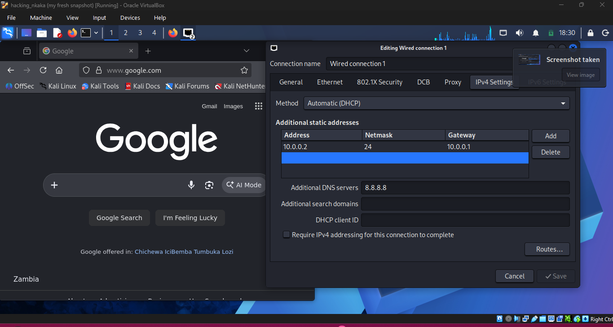

# Week 1 Project Module 1
# VirtualBox and Kali Linux Lab Setup

## Overview

This project documents the setup of a cybersecurity lab environment using Oracle VirtualBox and Kali Linux. The virtual machine was created manually and Kali Linux was installed directly from an ISO disk image. Networking was configured using a NAT Network, internet connectivity was verified, and a clean snapshot was created for future cybersecurity lab activities.

---

# Project Objectives

- Install Oracle VirtualBox
- Create and configure a NAT Network
- Create a Kali Linux virtual machine
- Install Kali Linux from an ISO image
- Configure networking
- Verify internet connectivity
- Create a fresh system snapshot
- Prepare a cybersecurity lab environment

---

# Host System Specifications

| Component | Specification |
|------------|--------------|
| Device Name | Nkaka |
| Operating System | Windows 11 Pro |
| Version | 26H2 |
| OS Build | 26300.9711 |
| Processor | Intel Core i7-8550U CPU @ 1.80GHz |
| Installed RAM | 16 GB (15.9 GB usable) |
| Graphics | Intel UHD Graphics 620 |
| Storage | 238 GB |
| System Type | 64-bit Operating System, x64-based processor |

## Host System Evidence

images/HOST-SYSTEM-SPECS.png

---

# Virtual Machine Specifications

| Component | Configuration |
|------------|--------------|
| Hypervisor | Oracle VirtualBox |
| Guest OS | Kali Linux |
| Installation Method | ISO Image Installation |
| Memory Allocation | 2048 MB RAM |
| Storage Type | Virtual Hard Disk |
| Network Type | NAT Network |
| IPv4 Network | 10.0.0.0/24 |
| DNS Server | 8.8.8.8 |
| Snapshot | Fresh Snapshot |

## Virtual Machine Evidence

images/VM-SPECS.png

---

# Tools Used

- Oracle VirtualBox
- Kali Linux ISO Image
- NAT Networking
- DHCP
- DNS Configuration
- Virtual Machine Snapshots

---

# Network Configuration

| Setting | Value |
|----------|--------|
| Network Type | NAT Network |
| IPv4 Prefix | 10.0.0.0/24 |
| DHCP | Enabled |
| DNS Server | 8.8.8.8 |

---

# Lab Setup Procedure

## Step 1: Install Oracle VirtualBox

Oracle VirtualBox was installed on the Windows host machine to create and manage virtual machines.

Purpose:

- Isolate the lab environment
- Run Kali Linux safely
- Enable snapshot creation
- Prepare a cybersecurity testing environment

---

## Step 2: Create NAT Network

A NAT Network was created inside VirtualBox before creating the virtual machine.

Configuration:

```text
Network Name: NatNetwork
Network Prefix: 10.0.0.0/24
DHCP: Enabled
```

This network allows virtual machines to access the internet while remaining isolated from the physical network.

### Evidence

images/NAT-NETWORK.png

---

## Step 3: Create Kali Linux Virtual Machine

A new virtual machine was created using Oracle VirtualBox.

Configuration:

```text
Operating System: Kali Linux (64-bit)
Memory Allocation: 2048 MB RAM
Storage Type: Virtual Hard Disk
Network Adapter: NAT Network
```

The official Kali Linux ISO image was attached as the installation media.

---

## Step 4: Install Kali Linux from ISO Image

Kali Linux was installed manually from a bootable ISO disk image.

Installation tasks completed:

- Boot installer from ISO
- Configure language
- Configure keyboard layout
- Configure hostname
- Create user account
- Set password
- Configure disk partitioning
- Install Kali Linux
- Install GRUB bootloader
- Reboot into Kali Linux

The operating system installed successfully and booted into the Kali Linux desktop environment.

---

## Step 5: Configure Network Settings

Network settings were configured to allow communication through the NAT Network.

Configuration:

```text
IP Address: 10.0.0.2
Gateway: 10.0.0.1
Subnet Prefix: /24
DNS Server: 8.8.8.8
```

This setup provides internet access and DNS resolution.

### Evidence

images/CONFIG-ADDRESSES-AND-DNS-SERVER.png

---

## Step 6: Verify Internet Connectivity

After configuring networking, internet access was verified.

Verification activities:

- Open web browser
- Access external websites
- Verify DNS resolution
- Confirm internet connectivity

Successful access to online resources confirmed that the network configuration was functioning correctly.

### Evidence


images/FULL-INTERNET-CONNECTIVITY.png

---

## Step 7: Create Fresh Snapshot

After installation and testing, a clean snapshot of the virtual machine was created.

Snapshot Details:

```text
Snapshot Name: my fresh snapshot
```

Benefits:

- Quick system recovery
- Preservation of clean installation
- Safe rollback point before future experiments
- Stable baseline environment

### Evidence

images/FRESH-SNAPSHOT.png

---

# Challenges Encountered

## Network Configuration

Understanding and configuring VirtualBox NAT Networking to ensure internet connectivity inside the virtual machine.

## Connectivity Verification

Testing DNS and internet connectivity to confirm proper communication with external resources.

## Virtual Machine Resource Allocation

Allocating sufficient memory and storage while maintaining system performance on the host machine.

---

# Skills Acquired

Through this project I gained experience in:

- Oracle VirtualBox Administration
- Virtualization Technologies
- Kali Linux Installation
- Operating System Deployment
- Network Configuration
- DNS Configuration
- Internet Connectivity Testing
- Snapshot Management
- Cybersecurity Lab Preparation

---

# Key Learning Outcomes

This project provided hands-on experience in:

- Creating virtual environments
- Installing Linux operating systems
- Managing network configurations
- Creating and restoring snapshots
- Troubleshooting connectivity issues
- Building secure lab environments

The completed virtual machine will be used as the foundation for future cybersecurity, networking, and penetration testing exercises.

---

# Project Status

✅ Oracle VirtualBox Installed

✅ NAT Network Configured

✅ Kali Linux Installed from ISO

✅ Network Settings Configured

✅ Internet Connectivity Verified

✅ DNS Configuration Completed

✅ Fresh Snapshot Created

✅ Cybersecurity Lab Ready

---

# Repository Structure

```text
NETWORKS-W1-LAB-PROJECT/
│
├── README.md
│
└── images/
    ├── HOST-SYSTEM-SPECS.png
    ├── VM-SPECS.png
    ├── NAT-NETWORK.png
    ├── CONFIG-ADDRESSES-AND-DNS-SERVER.png
    ├── FULL-INTERNET-CONNECTIVITY.png
    └── FRESH-SNAPSHOT.png
```

---