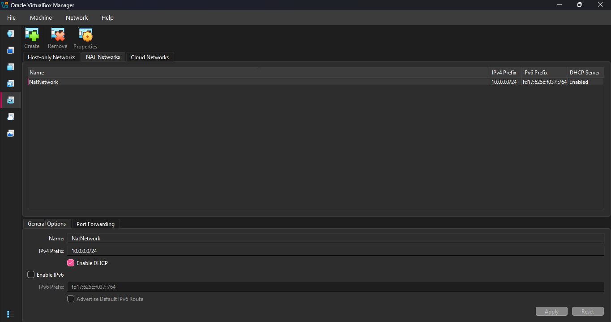
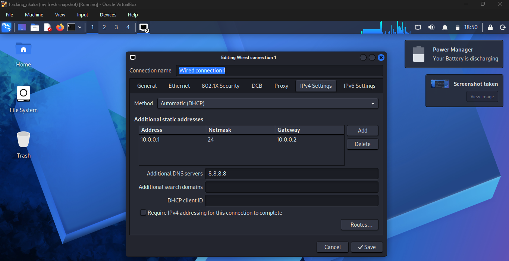
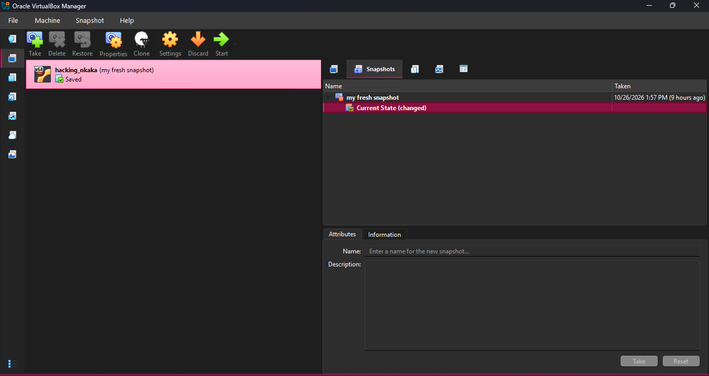

# Week 1 Project Module 1
# VirtualBox and Kali Linux Lab Setup

## Overview

This project documents the creation of a cybersecurity laboratory environment using Oracle VirtualBox and Kali Linux. The objective was to install Kali Linux from an ISO image, configure networking, verify internet connectivity, and create a clean snapshot for future cybersecurity exercises.

---

# Project Objectives

- Install Oracle VirtualBox
- Create a NAT Network for virtual machine communication
- Install Kali Linux using an ISO disk image
- Configure network settings
- Verify internet connectivity
- Create a clean system snapshot
- Prepare a secure cybersecurity lab environment

---

# Host System Specifications

The lab environment was created on the following host machine:

| Component | Specification |
|------------|-------------|
| Device Name | Nkaka |
| Operating System | Windows 11 Pro |
| Version | 26H2 |
| OS Build | 26300.9711 |
| Processor | Intel® Core™ i7-8550U CPU @ 1.80 GHz |
| Installed RAM | 16 GB (15.9 GB usable) |
| Graphics | Intel UHD Graphics 620 |
| Storage Capacity | 238 GB |
| System Type | 64-bit Operating System, x64-based Processor |

## Evidence


---

# Virtual Machine Specifications

The virtual machine was configured as follows:

| Component | Configuration |
|------------|-------------|
| Hypervisor | Oracle VirtualBox |
| Guest Operating System | Kali Linux |
| Installation Method | ISO Disk Image Installation |
| Virtual RAM | 2048 MB |
| Virtual Storage | Virtual Hard Disk |
| Network Adapter | NAT Network |
| Network Address Range | 10.0.0.0/24 |
| DNS Server | 8.8.8.8 |
| Snapshot Status | Fresh Installation Snapshot Created |

## Evidence


---

# Tools Used

- Oracle VirtualBox
- Kali Linux ISO Image
- NAT Networking
- DHCP
- DNS Configuration
- Virtual Machine Snapshots

---

# Lab Setup Procedure

## Step 1: Install Oracle VirtualBox

Oracle VirtualBox was installed on the host system to provide a virtualized environment for running Kali Linux.

Purpose:

- Run Kali Linux safely
- Isolate testing activities
- Create restore points through snapshots
- Build a cybersecurity learning environment

---

## Step 2: Create NAT Network

Before creating the virtual machine, a NAT Network was configured in VirtualBox.

Network Configuration:

```text
Network Name: NatNetwork
IPv4 Network: 10.0.0.0/24
DHCP: Enabled
```

This network configuration provides internet access to the virtual machine while keeping the environment isolated from the host network.

### Evidence



---

## Step 3: Create Kali Linux Virtual Machine

A new virtual machine was created in VirtualBox.

Configuration:

```text
Operating System: Kali Linux (64-bit)
Memory Allocation: 2048 MB
Storage Type: Virtual Hard Disk
Network Mode: NAT Network
```

The Kali Linux ISO image was mounted as installation media.

---

## Step 4: Install Kali Linux from ISO Image

Unlike importing a prebuilt virtual appliance, Kali Linux was installed manually using an ISO disk image.

Installation Process:

- Boot from Kali Linux ISO
- Select installation language
- Configure keyboard layout
- Configure hostname
- Create user account
- Create user password
- Configure disk partitioning
- Install operating system
- Install GRUB bootloader
- Reboot into Kali Linux

The installation completed successfully and the Kali desktop environment loaded correctly.

---

## Step 5: Configure Network Settings

After installation, network settings were configured to enable internet connectivity.

Configuration:

```text
IP Address: 10.0.0.2
Gateway: 10.0.0.1
Subnet Prefix: /24
DNS Server: 8.8.8.8
```

This configuration allows the virtual machine to communicate through the VirtualBox NAT Network and access internet resources.

### Evidence



---

## Step 6: Verify Internet Connectivity

Internet connectivity was verified after network configuration.

Verification activities included:

- Testing network communication
- Loading external websites
- Confirming DNS functionality
- Confirming successful internet access

The system successfully connected to external web resources.

### Evidence


---

## Step 7: Create Fresh System Snapshot

After successfully completing installation and network configuration, a virtual machine snapshot was created.

Snapshot Details:

```text
Snapshot Name: my fresh snapshot
```

Purpose:

- Preserve a clean working installation
- Create a recovery point
- Allow restoration if system changes cause issues
- Maintain a stable baseline environment

### Evidence



---

# Challenges Encountered

## Network Configuration

Understanding VirtualBox NAT networking required configuring virtual networking correctly so the virtual machine could communicate with external resources.

## Connectivity Verification

Testing and verifying internet connectivity helped ensure proper DNS resolution and network routing.

## Virtual Machine Setup

Allocating resources appropriately ensured that Kali Linux operated efficiently without affecting the host operating system.

---

# Skills Acquired

During this project I gained experience in:

- Virtualization Technologies
- Oracle VirtualBox Administration
- Operating System Installation
- Kali Linux Installation
- Virtual Networking
- NAT Configuration
- DNS Configuration
- Internet Connectivity Verification
- Snapshot Management
- Cybersecurity Lab Preparation

---

# Key Learning Outcomes

This project provided practical hands-on experience with:

- Building a virtual cybersecurity environment
- Installing and configuring Linux operating systems
- Managing virtual machine networking
- Creating recovery snapshots
- Validating network connectivity
- Preparing infrastructure for future cybersecurity activities

The completed virtual lab provides a stable foundation for future penetration testing, networking, and cybersecurity projects.

---

# Project Status

✅ Oracle VirtualBox Installed

✅ NAT Network Configured

✅ Kali Linux Installed from ISO Image

✅ Network Settings Configured

✅ Internet Connectivity Verified

✅ DNS Configuration Completed

✅ Fresh Snapshot Created

✅ Cybersecurity Lab Environment Ready

---

# Repository Structure

```text
NETWORKS-W1-LAB-PROJECT/
│
├── README.md
│
└── images/
    ├── HOST-SYSTEM-SPECS.png
    ├── VM-SPECS.png
    ├── 